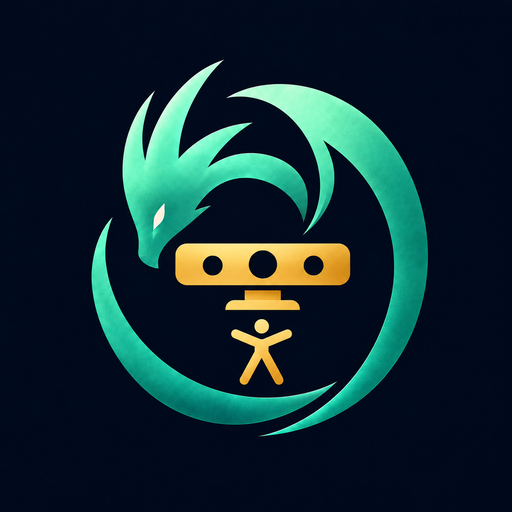

# Kinect Hoard

Estudio local para explorar, grabar y reutilizar las capacidades de Kinect One y Kinect 360 desde una API de cámara común.



## Qué es

Kinect Hoard detecta los dos modelos de Kinect, los abre bajo demanda y ofrece sus flujos, el seguimiento corporal, el escaneo 3D, el rostro, el audio y los gestos como funciones que se pueden usar desde una interfaz web, desde una aplicación de escritorio, desde la línea de comandos o desde agentes por MCP. Cada capacidad lleva un catálogo documentado con su código propio, pensado para adaptarlo a otra aplicación.

También incluye un modo de captura de movimiento con webcams o vídeos, que no necesita Kinect.

## Qué hace

**Cámara**
- Color RGB, profundidad, infrarrojos, infrarrojos de larga exposición, índice corporal y color registrado sobre profundidad (los tres últimos según modelo; larga exposición, índice corporal y «sin fondo» son de la One).
- Vista de las dos cámaras a la vez, cada una con su propia reconexión.
- Recuperación automática del flujo cuando Windows vuelve a enumerar el sensor tras un corte USB.
- Salida limpia (`/camera-output`) utilizable como fuente Navegador en OBS.

**Cuerpo, avatar y gestos**
- Esqueleto de la One, avatar 2D, coordenadas cámara/profundidad y eliminación de fondo.
- Motor de gestos, con las demos ShapeGame y TicTacToe jugables con la mano.
- Envío de articulaciones en directo a un armature de Blender, con grabación de keyframes.

**Escáner 3D**
- Escáner en directo con flujo inicial **One · Cámara fija · Persona**: la máscara corporal separa el fondo y la superficie con color crece en directo. Seguimiento por ICP con color contra vistas clave, recolocación, descarte de brazos que se mueven y cierre de la vuelta con grafo de poses.
- **Finalizar y texturizar** exporta OBJ, MTL y atlas PNG.
- **Reproducir como en directo**: pasa una toma guardada o una persona sintética por el mismo motor, al ritmo de sus marcas de tiempo, y mide el resultado.
- **Refinar una toma**: reprocesa una toma guardada sin abrir la cámara y devuelve `refined.obj` con una tabla de métricas nativo/refinado.
- Escáner con textura de captura corta (`--quality`) que exporta OBJ + MTL + PNG, PLY e informe.
- Reconstrucción Fusion (TSDF en color) de sesiones RGBD, con límite de profundidad y región de interés.
- Escaneo dual One + 360 con calibración a partir de puntos 3D correspondientes.
- Nube de puntos y malla PLY de una toma, con y sin color; visor de mallas integrado.

**Rostro, audio y voz**
- Detector de rostro frontal 2D, seguimiento facial HD (puntos, orientación y malla) y captura de cara 3D.
- Grabación de audio WAV con metadatos de dirección del haz.
- Reconocimiento de comandos con el reconocedor local de Windows y una gramática editable (`speech-commands.txt`).

**Captura de movimiento**
- Pose 3D con una o varias webcams o vídeos; con varias cámaras se calibran las vistas con un tablero ChArUco o con puntos del cuerpo.
- Exporta BVH, GLB animado, JSON y CSV.

**Sesiones y herramientas**
- Grabación de sesiones `.khr` y reproducción sin sensor, con pausa y avance fotograma a fotograma.
- Servidor HTTP local con puentes de ejemplo para OpenCV (RGB y profundidad cruda) y MATLAB.
- Diagnóstico de cortes USB y de audio (`diagnose-usb.ps1`, `diagnose-audio.ps1`).

El [catálogo](docs/capabilities.json) indica para cada capacidad si está verificada, es parcial, solo entrega un flujo o está pendiente.

## Cómo ejecutarlo

Requisitos: Windows, .NET Framework 4.8 y el SDK de .NET 9 para compilar; Kinect Runtime 2.x para la One (`install-one-runtime.ps1` descarga el instalador oficial de Microsoft y comprueba su SHA-256); para la 360 por la ruta nativa, el controlador `libusbK` en la cámara (`install-360-driver.ps1` guía el cambio con Zadig, comprobando que el ID sea `045E:02AE`).

```powershell
.\build.ps1          # compila los módulos junto a KinectHoard.App.exe
.\run.ps1            # aplicación de escritorio
```

- **Interfaz web:** desde Hoard Hub se abre **Kinect Hoard**, o se lanza `hoard_server.py`; escucha en `http://127.0.0.1:64321` (salud en `/api/health`). Abrir la interfaz no enciende el sensor: **Conectar cámara** abre la vista previa y **Iniciar escaneo** comienza a integrar.
- **Escáner con Fusion:** `setup-scan.ps1` (script) o `build-scan.ps1` (ejecutable autónomo `KinectHoard.Fusion.exe`).
- **Captura de movimiento:** `setup-mocap.ps1` y abrir el modo desde el estudio.
- **Paquete para otro PC:** `package.ps1` genera `KinectHoard-One.zip` (almacenado en Git LFS) con ejecutable, módulo de cámara, biblioteca facial, documentación, catálogo y MCP; basta extraerlo en un Windows x64 y abrir `KinectHoard.App.exe`.
- **Línea de comandos:**

```powershell
KinectHoard.App.exe --capture captura.png Color          # Depth, Infrared, LongExposureInfrared, BodyIndex, Skeleton, BackgroundRemoved, ColorDepth
KinectHoard.App.exe --capture-raw profundidad.pgm Depth  # valores originales de 16 bits
KinectHoard.App.exe --bodies bodies.json                 # articulaciones
KinectHoard.App.exe --point-cloud | --mesh | --color-cloud | --color-mesh   # geometría PLY
KinectHoard.App.exe --record sesion.khr 10 Depth
KinectHoard.App.exe --replay-last sesion.khr ultimo.png
KinectHoard.App.exe --stress-dual prueba 60 Color Depth  # One y 360 en paralelo
```

`--capture-model 360` elige la 360. Los detalles de cada opción están en [docs](docs/).

## Conexión con Faustus y Hoard Hub

El manifiesto `faustus-plugin.json` (id `kinect-hoard`) registra la app en Faustus y en Hoard Hub: el Hub la abre bajo demanda con el tema común y el acceso a Faustus, y publica sus herramientas por el contrato compartido `/api/agent/tools` y `/api/agent/call`. La portada presenta diez modos (cámara; cuerpo, esqueleto y avatar; escáner; rostro; audio y voz; gestos e interacción; geometría; grabación y reproducción; integraciones; sensores) con sus 26 capacidades, acciones y referencias; ver [modos](docs/workspace.md).

Servidor MCP (`mcp_server.py`, transporte `stdio`, sin puerto ni nube; se prepara una vez con `setup-mcp.ps1`, que fija `KINECT_HOARD_DIR`). Conectarse no abre ninguna cámara y las capturas de imagen y audio devuelven rutas locales sin adjuntar los medios. Herramientas por grupo:

| Grupo | Herramientas |
| --- | --- |
| Catálogo y código | `list_capabilities`, `get_capability`, `read_hoard_source`, `list_modes`, `list_artifacts`, `open_studio`, `open_demo`, `sensor_status` |
| Cámara | `start_camera`, `camera_status`, `get_live_frame`, `close_camera`, `capture_artifact` |
| Escáner en directo | `start_live_scan`, `live_scan_status`, `control_live_scan`, `list_live_captures`, `refine_live_scan`, `refine_status`, `replay_live_capture`, `list_live_replays`, `replay_score` |
| Reconstrucción | `scan_3d`, `scan_head`, `fuse_session`, `fuse_textured_sessions`, `calibrate_dual_landmarks` |
| Rostro, audio, gestos | `analyze_face`, `capture_face3d`, `record_audio`, `recognize_speech`, `capture_gestures`, `analyze_gesture_session` |
| Sesiones y Blender | `record_session`, `replay_session`, `session_info`, `connect_blender` |
| Captura de movimiento | `mocap_cameras`, `mocap_snapshot`, `mocap_board`, `mocap_record`, `mocap_calibrate`, `mocap_process`, `mocap_status`, `mocap_list`, `mocap_export` |
| Skills | `skills_list`, `skill_read` |

El bloque `skills` del manifiesto nombra las skills de la biblioteca de la familia que encajan con la app: `depth-camera-capture` y `web-3d-asset-pipeline`. Más en [MCP y Faustus](docs/mcp.md).

## Estructura

| Ruta | Contenido |
| --- | --- |
| `KinectHoard.Core` | API `ICameraBackend`, formato de fotograma BGRA y detección USB sin SDK |
| `KinectHoard.Driver.One` | Backend de One sobre el runtime Kinect 2.0 |
| `KinectHoard.Driver.ThreeSixty` / `.Native` | Backend de 360 por SDK 1.8 y ruta nativa libfreenect/libusb con `libusbK` |
| `KinectHoard.App` | Estudio de escritorio (WinForms), CLI y catálogo; cada driver corre en su propio `AppDomain` |
| `hoard_server.py`, `ui/` | Servidor web local y interfaz |
| `mcp_server.py`, `faustus-plugin.json` | Servidor MCP y manifiesto |
| `fusion.py`, `quality_scan.py`, `turn_refine.py`, `mocap.py` | Fusion, escáner con textura, refinado de tomas y captura de movimiento |
| `docs/` | Documentación por capacidad y `capabilities.json` |
| `tests/` | Pruebas de humo y sintéticas |
| `captures/`, `data/` | Capturas y sesiones locales; token MCP |
| `licenses/` | Textos de licencias de terceros |

## Desarrollo y pruebas

Las pruebas están en `tests/` (por ejemplo `smoke_mcp.py`, `workspace-contract.py`, `live-replay.py`, `turn-refine-smoke.py`, `mocap-smoke.py`) y se ejecutan con el Python del entorno de la app. `build.ps1` compila; `build-native360.ps1` reconstruye las DLL nativas de la 360 desde fuentes fijadas.

## Límites conocidos

- El SDK 1.8 no reconoce la 360 en Windows 11; sus flujos (RGB, profundidad, infrarrojos y RGBD) se sirven por la ruta nativa. El esqueleto de la 360 solo existe por el SDK 1.8.
- La One puede perder el USB durante la transmisión por el propio controlador de Windows; Hoard reabre el flujo, pero no evita el corte. Ver [mediciones](docs/usb-findings.md) y [driver 360](docs/driver-360.md).
- El giro completo de una persona real y el escaneo dual limpio de un busto no están validados; no hay campo de deformación para cambios grandes de postura.
- Quedan sin integrar algunas demos del Developer Toolkit ([contratos](docs/next-capabilities.md)).

## Datos, privacidad y licencias

Todo se procesa en local; las capturas, sesiones y audio se guardan en `captures/`. [PRIVACY.md](PRIVACY.md) detalla qué se procesa, cuándo se guarda y qué interfaces locales acceden. Licencias de terceros (OpenCV, OpenCvSharp, Open3D, libfreenect, libusb, xatlas) en [THIRD_PARTY_NOTICES.md](THIRD_PARTY_NOTICES.md) y `licenses/`.
